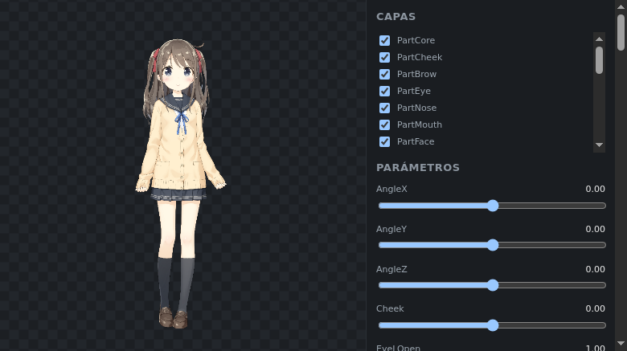
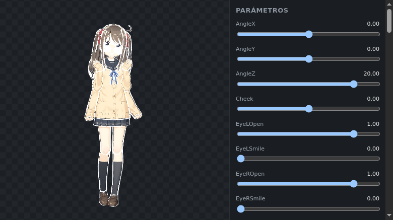
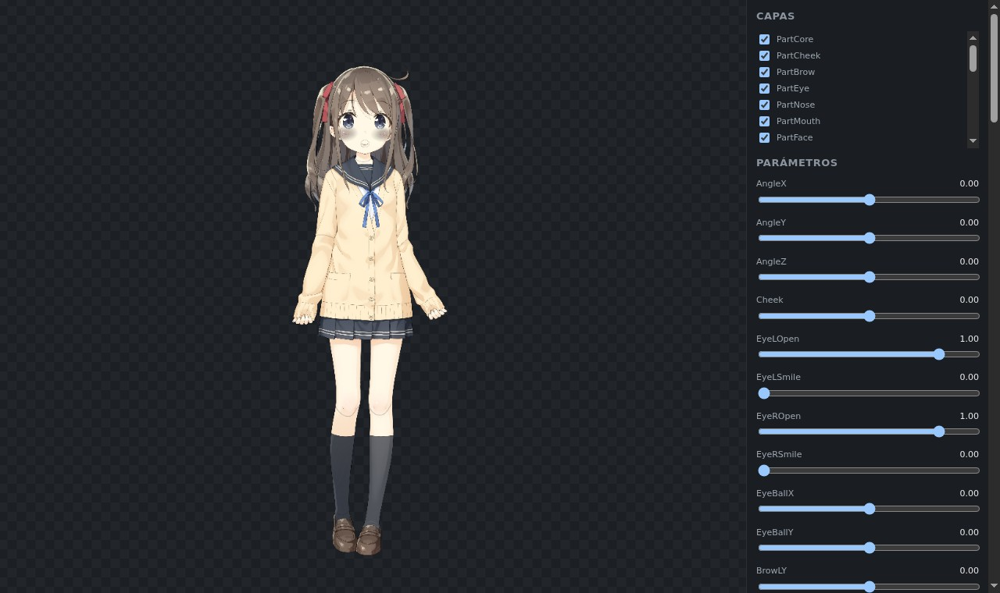

# l2d-viewer

Visor de modelos Live2D **en Rust, escrito desde cero**. No es un port, no es un parche y no
contiene ni una línea del editor de Live2D: es una implementación independiente del *formato*
y del *comportamiento*, no del código.

> El nombre del directorio es de trabajo. Un producto publicable **no** debe llevar «Live2D» en
> el nombre (marca registrada); ver `docs/05-licencias.md`.

## Estado

| Pieza | Estado |
|---|---|
| Lector del contenedor `.moc3` (cabecera, canvas, tabla de secciones) | ✅ probado contra 8 modelos reales |
| Lector de `.model3.json` | ✅ |
| Rasterizador CPU (triángulos, UV, blend modes, máscaras) → PNG | ✅ |
| Cuerpo del modelo: partes, mallas, parámetros, keyforms, máscaras | ✅ verificado contra `py-moc3` |
| Orden de dibujo por parte + visibilidad | ✅ |
| Selección de keyform por parámetro | ✅ calibrada contra el Core: el keyform de reposo es el 0 (`docs/07`) |
| **Evaluador propio (deformadores warp/rotation)** | ✅ **134/134 mallas** de Hiyori y **34/34** de Wanko, también en poses movidas (`docs/16`) |
| Editor: sliders, vértices, capas, máscaras, claves, timeline, export | ✅ prototipo funcional (sobre el Core) |
| Cargar lo exportado y borrar claves (ida y vuelta de `l2d-anim/1`) | ✅ verificado en navegador |
| Guardar el modelo editado (`l2d-model/1`) y reabrirlo | ✅ verificado en navegador (`docs/14`) |
| Validar un `.l2d` desde Rust (`l2d edit`) | ✅ |
| **Visor con interfaz** sobre el motor propio (`l2d-ui`) | ✅ ventana con deslizadores y capas, sin Core (`docs/17`) |
| Abrir modelos y animaciones desde la ventana | ✅ selector `zenity` (`docs/18`) |
| **Reproducir `l2d-anim/1`** con el motor propio | ✅ bucle a 15 cuadros/s, con banco de ms medido (`docs/18`) |
| **Zoom y centro de cámara** (rueda, flechas, `--zoom/--centro`) | ✅ 1:1 idéntico al dibujo sin encuadre (`docs/19`) |
| **Orden de dibujo por grupos** (`draw_order_group`) | ✅ leído y usado como desempate; medido contra el Core (`docs/20`) |

> Estado real: lector de formato sólido, renderizador de geometría correcto y un **editor usable**
> que deforma con el Core oficial. Unirlos (rig propio en Rust) no está empezado.
> Cierre del tramo editor y siguiente paso: `docs/10-cierre-del-editor.md`.

```bash
cargo test                              # 35 pruebas + 1 doctest
cargo run -p l2d -- render modelo.moc3 textura.png out.png 0.3
cargo run -p l2d -- body modelo.moc3    # partes, mallas, parámetros
cargo run -p l2d -- params modelo.moc3  # parámetros reales con min/max/defecto
cargo run -p l2d -- edit modelo.l2d modelo.moc3   # valida el modelo editado
cargo run -p l2d -- pose modelo.moc3 --oraculo dump.json   # evalúa con el motor propio
cargo run -p l2d -- ver  modelo.moc3 out.png --ancho 700   # dibuja la pose, sin Core
tools/visor.sh                                          # abre el visor (interfaz)
cargo run -p l2d -- inspect modelo.moc3
tools/editor.sh                         # editor (Hiyori); tools/editor.sh Wanko
```

## Documentos

1. `docs/01-protocolo-cuarentena.md` — **el más importante**: qué se puede mirar y qué no.
2. `docs/02-arquitectura.md` — crates, fronteras y por qué Rust.
3. `docs/03-formato-moc3.md` — el contenedor, verificado contra especificación pública.
4. `docs/04-hoja-de-ruta.md` — de visor a editor, con hitos binarios.
5. `docs/05-licencias.md` — qué licencia tiene *este* código y qué pasa con el SDK.
6. `docs/06-primer-render.md` — qué se dibuja hoy, qué falta y por qué.
7. `docs/07-cierre-de-fase.md` — cierre de la fase de investigación del formato.
8. `docs/08-editor-arquitectura.md` — arquitectura del editor e hitos H1–H5.
9. `docs/09-sdk-sin-algoritmo.md` — por qué el SDK no trae el algoritmo de deformación.
10. `docs/10-cierre-del-editor.md` — el estado del editor al 14 nov: qué hay, qué no, cómo retomar.
11. `docs/11-cargar-animacion.md` — ida y vuelta de `l2d-anim/1` en el editor.
12. `docs/12-plan-deformacion.md` — plan del evaluador propio (warp/rotation).
13. `docs/13-formulas-medidas.md` — fórmulas verificadas de la deformación y lo que sigue abierto.
14. `docs/14-guardar-modelo.md` — **guardar el modelo** (`l2d-model/1`), con la verificación en navegador.
15. `docs/15-motor-en-rust.md` — el evaluador propio en Rust y cuánto acertaba antes (12/134).
16. `docs/16-motor-cerrado.md` — **el motor cerrado**: composición + selección con pesos, 134/134.
17. `docs/17-interfaz.md` — el visor con interfaz (`l2d-ui`) y los tres defectos que salieron al dibujar.
18. `docs/18-animacion.md` — abrir archivos y **reproducir `l2d-anim/1`**, con el rendimiento medido y el halo del borde descartado como defecto.
19. `docs/19-encuadre.md` — **zoom y centro de cámara**, con el eje que costó una vuelta.
20. `docs/20-orden-de-dibujo.md` — el **orden de dibujo** por grupos del archivo, medido contra el Core.
21. `docs/21-diferencia-con-el-core.md` — el **8,6 % restante**: supermuestreo (`--ssaa`) y las hipótesis descartadas con números.
- `spec/01-formato-animacion.md` y `spec/02-formato-modelo.md` — los dos formatos propios.

## La regla

Este repositorio **no lee** `~/Proyectos/live2d-cubism-linux/dist/app/lib/Live2D_Cubism.jar`.
Ni descompilado, ni traducido, ni «inspirado en una función concreta del bytecode».
Ver `docs/01`.


## Estado (2026-11-13)

**Render visualmente correcto, verificado con dos modelos oficiales (Hiyori, Wanko).**

```bash
l2d oracle <dump.json> <texture_00.png> <salida.png> [zoom]
```

`oracle` renderiza a partir de la geometría que entrega el **Core oficial** (SDK de Live2D),
volcada a JSON por `models/samples/dump.html`. Sirve para dos cosas: tener un visor que se ve
bien hoy, y como verdad de referencia para validar el parser propio.

Hallazgos que hicieron posible el render correcto:

| Causa | Efecto |
|---|---|
| UV con V sin invertir | modelo "despiezado": cada triángulo pinta otra zona del atlas |
| Mallas fuente de máscara dibujadas como arte | bloque blanco tapando el torso |
| Parámetros sin `defaultValues` | deformación a cero |

Pendiente para que el visor sea **independiente** (sin Core): resolver keyform por malla y la
cadena de deformadores. Ahora hay contra qué validarlo: el JSON del oráculo.


## Editor: primer ladrillo

```bash
l2d params <modelo.moc3>
```

Enumera los parámetros reales del modelo (id, mínimo, máximo, valor por defecto) leyendo el
`.moc3` con el parser propio. Es la lista sobre la que se construye el animador: cada fila es un
control que el usuario va a mover.

Hiyori declara 24 parámetros: ángulos de cabeza, apertura y sonrisa de ojos, mirada, cejas,
boca, respiración, posiciones de brazos y cuerpo. Los valores por defecto son los que definen la
pose de reposo que ya se renderiza correctamente.


## Editor (prototipo funcional)

```bash
tools/editor.sh            # Hiyori por defecto
tools/editor.sh Wanko
```

Sirve la **raíz del repo** por HTTP y abre `editor/editor.html`: lienzo con el personaje y **panel
de sliders** para todos sus parámetros (70 en Hiyori). Al mover un slider, el modelo se deforma y
se redibuja en el acto.

Cómo está hecho: geometría y deformación por el **Core oficial** (SDK); rasterizado propio en
**WebGL2** con alfa premultiplicado y `v' = 1 - v`. Se excluyen del dibujo las mallas que son
fuente de máscara y el `HitArea` (área de impacto, no arte).


### Edición de vértices

Botón **Editar vértices**: aparecen los nodos de la malla; arrastrar uno lo mueve y la malla se
deforma en vivo. **Deshacer** revierte (pila de estados). Los desplazamientos se guardan por
`malla:vértice` y se aplican al subir los vértices a la GPU, de modo que la deformación del Core
y la edición del usuario conviven sin pisarse.


### Sistema de capas y máscaras

Dos defectos corregidos, ambos del sistema de capas:

| Síntoma | Causa | Arreglo |
|---|---|---|
| Halo/borde blanco en todo el contorno | el atlas usa alfa recto y se dibujaba con mezcla premultiplicada sin premultiplicar | `o = vec4(c.rgb * c.a, c.a)` y clamp de UV a medio téxel |
| Cuatro brazos | las mallas con máscara se dibujaban sin recortar: las variantes de brazo se sumaban | esténcil: se escribe la forma de cada máscara y la malla se dibuja solo donde todas coinciden |

El esténcil se incrementa por cada máscara y la malla exige `EQUAL` al número de máscaras, que es
el recorte por intersección que usa Cubism.

### Panel de capas

Arriba del panel, una casilla por **parte** del modelo (24 en Hiyori). Ocultar una parte apaga
todas sus mallas. Por defecto se ocultan las variantes mutuamente excluyentes del nombre
`PartArmA` / `PartArmB`: el modelo trae dos juegos completos de brazo y solo uno debe estar activo.
Sin eso aparecen cuatro brazos.



La opacidad con la que se dibuja cada malla es **malla × parte × visibilidad de capa**.

### Claves y timeline

Panel **Animación**: se fija un tiempo, se mueven los sliders y se pulsa **Añadir clave**.
**Reproducir** interpola linealmente entre claves y hace bucle; **Exportar .json** descarga la
animación en el formato `l2d-anim/1` (`spec/01-formato-animacion.md`) y **Cargar .json** la vuelve a
abrir: el ciclo está cerrado y el archivo se valida al entrar (formato, lista de parámetros, orden y
longitud de las claves). **Borrar clave** quita la del tiempo actual.



Verificado: dos claves (`AngleZ` −20 en 0 s, +20 en 2 s) dan 0 en 1 s y 10 en 1,5 s; la
reproducción avanza con el reloj real y repinta.

Y verificado en navegador: exportar esas dos claves y volver a cargar el archivo deja **las 140
cifras idénticas** (70 parámetros × 2 claves), con la misma duración; los archivos mal formados se
rechazan con el motivo exacto y no tocan la animación que estaba abierta.



### Guardar el modelo

Panel **Modelo**: **Guardar .l2d** escribe un `l2d-model/1` (`spec/02-formato-modelo.md`) con **solo
lo que cambió** —parámetros fuera de reposo, partes ocultas o mostradas y desplazamientos de
vértices— y **Abrir .l2d** lo vuelve a aplicar. El `.moc3` nunca se reescribe.

El documento se ata a su modelo por tamaño y huella FNV-1a 64 del `.moc3`: abrir el `.l2d` de Hiyori
sobre Wanko se rechaza con los dos valores en el mensaje, porque los índices de vértice no significan
lo mismo en otro archivo. La carga valida el archivo **entero** antes de tocar nada, y devuelve el
modelo a su estado base antes de aplicar, así que un archivo vacío deja el modelo intacto.

Verificado en navegador: tres cambios hechos con la UI (slider, casilla de parte, arrastre de vértice)
salen en el archivo, y tras reabrir con el `input` real el framebuffer da **la misma huella de
píxeles**. Detalle y tabla de rechazos en `docs/14-guardar-modelo.md`.

```bash
cargo run -p l2d -- edit modelo.l2d modelo.moc3   # válida sin navegador
```

## Motor propio (`crates/pose`)

`cargo run -p l2d -- pose <modelo.moc3> --oraculo <dump.json>` evalúa la pose con el motor
escrito en Rust —selección de keyform por parámetro, rotaciones y warps— y mide la desviación
contra el volcado del Core, malla por malla.

Números: **134 de 134 mallas** de Hiyori y **34 de 34** de Wanko dentro de 1e-3, mediana
4,9·10⁻⁶ (precisión de `f32`), y lo mismo en poses movidas (`ParamAngleZ=±10`, `ParamEyeBallX=1`).
La deformación se **compone** deformador a deformador —cada uno con su padre, con herencia de
escala y sondeo del ángulo— y los keyforms se **interpolan** con pesos; eso era lo que faltaba
(`docs/16-motor-cerrado.md`). `--malla ID` imprime la cadena, el keyform y su peso en cada
eslabón y el bbox tras cada paso.

## Visor con interfaz

```bash
tools/visor.sh                     # Hiyori; tools/visor.sh ruta/modelo.moc3 para otro
```

Ventana con un deslizador por parámetro, una casilla por capa, «Volver a reposo», «Guardar PNG» y
tema claro/oscuro. **«Abrir modelo…» y «Abrir animación…»** usan el selector del sistema (`zenity`),
y la animación se reproduce en bucle con «Pausar»/«Detener».

```bash
./target/release/l2d-ui <modelo.moc3> <anim.json>   # abre y reproduce al arrancar
L2D_UI_LOG=1 tools/visor.sh                          # ms de dibujo cada 24 cuadros
cargo run --release -p view --example banco -- <modelo.moc3>   # ms por pose a cada ancho
l2d ver <modelo.moc3> /tmp/cara.png --zoom 4 --centro 1488,700  # primer plano del rostro
l2d ver <modelo.moc3> /tmp/cara.png --zoom 6 --centro 1420,760 --ssaa 2  # con supermuestreo
l2d-ui <modelo.moc3> --zoom 4 --centro 1488,700                # la ventana, ya en la cara
cargo run --release -p moc3 --example grupos -- <modelo.moc3>  # árbol de grupos de dibujo
cargo run --release -p view --example comparar -- <modelo.moc3> 560  # orden antiguo vs nuevo
```

Para mirar de cerca: **rueda** acerca, **flechas** mueven, **0** vuelve al modelo entero (o los
botones `+` `−` `Todo`). `--centro` va en píxeles de imagen (origen arriba-izquierda).

Dibuja el motor propio en CPU (`crates/pose` + `crates/raster`), así que **no carga el Core** y no
depende del EGL de la tarjeta. Detalle y pendientes: `docs/17-interfaz.md` y `docs/18-animacion.md`.

## Ramas

`main` es la rama estable (lo que está probado y documentado); todo el desarrollo va en `dev`.
`main` solo se mueve cuando `dev` está estable, a mano.

## Licencia y alcance

Código bajo `MIT OR Apache-2.0` (ver `LICENSE-MIT` y `LICENSE-APACHE`); `docs/05-licencias.md`
explica el resto.

- Proyecto **independiente**, sin relación con Live2D Inc. «Live2D» es marca de su titular y aquí
  solo se nombra el formato que este código lee.
- No redistribuye binarios ni código de Live2D, ni modelos de muestra: `models/` está en
  `.gitignore` porque cada modelo tiene su propia licencia.
